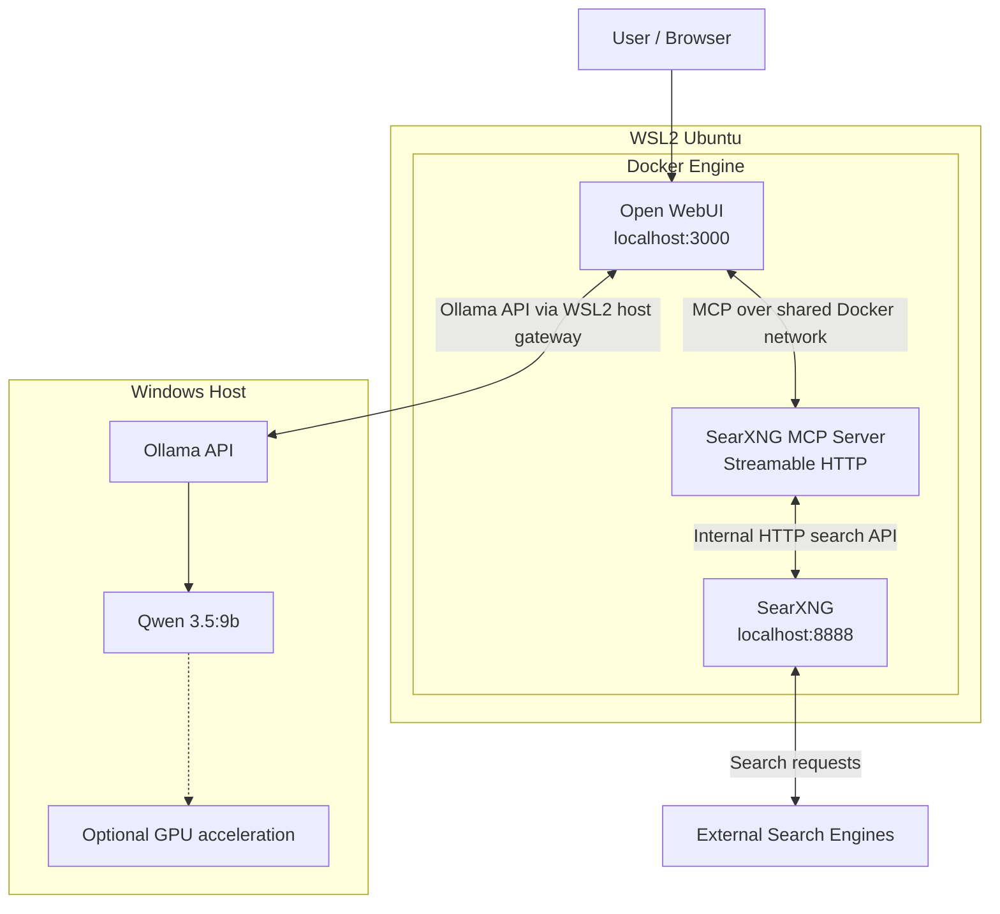
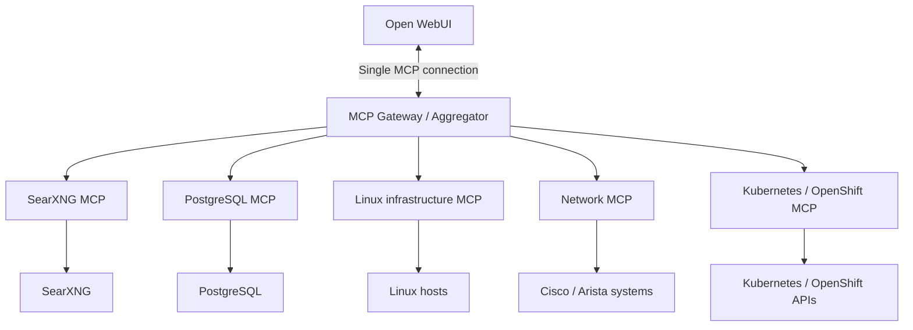

# Architecture

## High-level component diagram

## Request flow

1. The user enters a question in Open WebUI.
2. Open WebUI sends the prompt to the locally hosted Qwen model through the Ollama API.
3. When external information is needed, the model can request the SearXNG search tool exposed through MCP.
4. Open WebUI sends the MCP request to the SearXNG MCP server over the shared Docker network.
5. The MCP server queries the SearXNG HTTP search API.
6. SearXNG queries its configured external search engines and returns results.
7. Results return through MCP to Open WebUI, where Qwen summarizes them for the user.

## Network boundaries

| Connection | Addressing concept | Exposure |
|---|---|---|
| Browser to Open WebUI | Windows localhost port 3000 | Bound to host loopback |
| Browser/CLI to SearXNG | WSL2 localhost port 8888 | Bound to host loopback |
| Browser/CLI to MCP health/API | WSL2 localhost port 8889 | Bound to host loopback |
| Open WebUI to MCP | Docker DNS name and container port 8080 | Internal shared Docker network |
| Open WebUI to Ollama | Windows host gateway and port 11434 | Windows Firewall should restrict to WSL2 |
| SearXNG to search engines | Outbound internet | External HTTPS/search traffic |

The Windows host gateway and WSL2 subnet are assigned by the local environment and must be discovered on each installation. They are intentionally not recorded as fixed addresses here.

## Container network

The SearXNG Compose project creates a Docker network (in this setup, `searxng-mcp_default`). Open WebUI is attached to that network so it can resolve the MCP container by its Docker DNS name.

The browser-facing host ports are not used for the Open WebUI-to-MCP connection. That connection uses:

`http://searxng-mcp:8080/mcp`

## Persistence

- Open WebUI uses the Docker volume `open-webui` to retain application state.
- SearXNG uses its configured settings mount and a local environment file for its secret.
- Docker containers can be restarted without rebuilding the model or recreating the Open WebUI account, provided their persistent storage is retained.

## Security boundaries

- Host-published service ports should bind to loopback unless remote access is explicitly required and secured.
- The MCP service should remain on the internal Docker network for application-to-application traffic.
- Ollama's host API needs a narrowly scoped firewall allowance for the WSL2 environment; do not expose it publicly.
- Secrets and application data stay on the local machine and are excluded from this repository.

## Future MCP gateway architecture

The current implementation has a direct connection from Open WebUI to the SearXNG MCP server. The future design may introduce an MCP gateway/aggregator as a single client-facing endpoint:

This is a planned architecture only. It is not part of the currently deployed stack. The gateway would route requests and apply shared access policies, while specialized backend MCP servers would retain their own credentials, permissions, and backend integrations. Candidate projects and an evaluation checklist are documented in [FUTURE_ROADMAP.md](FUTURE_ROADMAP.md).
