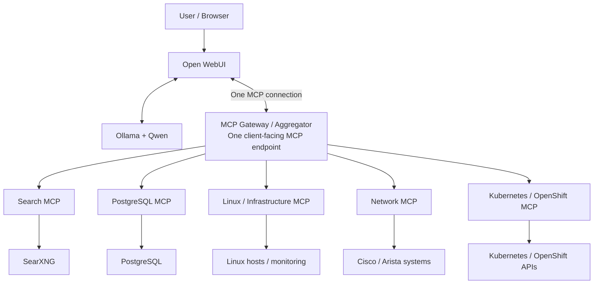

# Future Projects and MCP Expansion Roadmap

## Direction

The long-term direction is to evolve the current local web-search assistant into a modular AI assistant that can work with multiple systems through Model Context Protocol (MCP).

The intended client experience is a single Open WebUI connection to an MCP gateway/aggregator. The gateway would route tool calls to separate, specialized MCP servers or API adapters.

This is a future architecture, not the current deployment. Today, Open WebUI connects directly to the SearXNG MCP server.

## Target architecture

The gateway should provide routing and centralized policy while the individual MCP servers remain responsible for their own backend integrations. This preserves separation of duties and makes it possible to replace or upgrade one integration without redesigning the entire assistant.

## Planned tool domains

| Planned integration | Example capabilities | Initial permission model |
|---|---|---|
| Web search | Search public sources and return links | Read-only |
| PostgreSQL | Query approved tables, summarize records, generate reports | Read-only database role |
| Linux infrastructure | Retrieve host inventory, CPU, memory, disk, service status, and approved logs | Read-only |
| Network infrastructure | Retrieve device inventory, interface state, VLAN and configuration summaries | Read-only |
| Kubernetes / OpenShift | Inspect clusters, nodes, pods, deployments, services, and events | Read-only |
| Monitoring | Retrieve alerts, metrics, and historical health information | Read-only |

Write or administrative functions should be introduced only after authentication, authorization, approval, audit logging, and recovery procedures are in place.

## Gateway / aggregator candidates to evaluate

These are candidate projects for technical evaluation, not endorsements or confirmed selections. Their current maintenance status, license, deployment requirements, security model, protocol support, and compatibility with Open WebUI must be checked before adoption.

### Microsoft MCP Gateway

Repository: https://github.com/microsoft/mcp-gateway

A gateway project focused on routing MCP requests, managing MCP server adapters, and providing control-plane and authorization capabilities. Its README describes Kubernetes-oriented deployment and Entra ID integration. Check its current MCP protocol requirements carefully: protocol-version compatibility with the client and upstream servers is a release-specific requirement.

### OpenZiti MCP Gateway

Repository: https://github.com/openziti/mcp-gateway

An aggregation approach built around OpenZiti and zrok/Agora connectivity. Its project documentation describes combining multiple backends, including stdio and HTTP MCP servers, behind one connection. It may be particularly relevant when securely connecting tools across hosts or private networks without publicly exposing their endpoints. Evaluate the additional OpenZiti/zrok components and operational complexity.

### unrelated-ai MCP Gateway

Repository: https://github.com/unrelated-ai/mcp-gateway

A gateway/adapter project describing aggregation of remote MCP servers and REST/OpenAPI sources into profile-based MCP endpoints, with authentication and tool policies. Evaluate its deployment model, maturity, licensing, and compatibility before selecting it.

## Evaluation checklist

Before choosing a gateway, test:

1. Can Open WebUI connect using the required MCP transport and protocol version?
2. Can it aggregate the current SearXNG MCP server and a second test MCP server?
3. Does the client see useful, non-conflicting tool names and descriptions?
4. Can tools be allowlisted by profile, user, or role?
5. Are upstream credentials stored securely and kept out of logs?
6. Does it support authentication, authorization, TLS, and audit logging?
7. What happens when one backend is unavailable or slow?
8. Can the gateway and its configuration be backed up and restored?
9. Can it run in the current Docker/WSL2 lab, or does it require Kubernetes or additional infrastructure?
10. Is the project actively maintained and compatible with the MCP protocol version used by the client?

## Suggested implementation sequence

### Project 1 — Complete the current web-search assistant

- Stabilize the existing Open WebUI, Ollama, SearXNG, and SearXNG MCP integration.
- Pin tested image versions.
- Document startup, shutdown, backups, and troubleshooting.
- Add basic health checks and service monitoring.

### Project 2 — Add PostgreSQL

- Deploy PostgreSQL separately.
- Create a sample database with non-sensitive test data.
- Add a dedicated PostgreSQL MCP server.
- Start with a read-only database account and restrict it to approved schemas and tables.
- Test structured queries, invalid requests, and permission boundaries.

### Project 3 — Evaluate an MCP gateway

- Deploy one candidate gateway in an isolated test environment.
- Connect the existing SearXNG MCP server and the PostgreSQL MCP server as upstreams.
- Configure a single client-facing MCP endpoint.
- Connect Open WebUI to that endpoint.
- Confirm both search and database tools work, then test tool filtering, authentication, backend failures, and logs.

### Project 4 — Infrastructure integrations

- Add read-only Linux host inventory and monitoring tools.
- Add read-only network inventory and device-state tools.
- Add Kubernetes/OpenShift inspection tools.
- Keep each integration in its own service or adapter where practical.

### Project 5 — Operational and security maturity

- Add identity integration, role-based access, TLS, audit logging, alerting, and tested backups.
- Define separate read-only and administrative tool profiles.
- Introduce write actions only with explicit authorization and appropriate approval controls.
- Conduct security and operational acceptance testing before a shared deployment.

## Design principles

- **One client connection, many backend integrations:** Open WebUI should have a stable entry point as the number of tools grows.
- **Keep integrations modular:** avoid turning the gateway into a monolithic application containing every backend integration.
- **Least privilege by default:** begin with read-only tools and narrowly scoped service accounts.
- **Keep secrets out of Git:** use local protected files or a secrets manager.
- **Fail safely:** a failed backend should not grant broader access or silently perform a different action.
- **Document what is implemented:** distinguish current tested behavior from planned architecture and future work.
